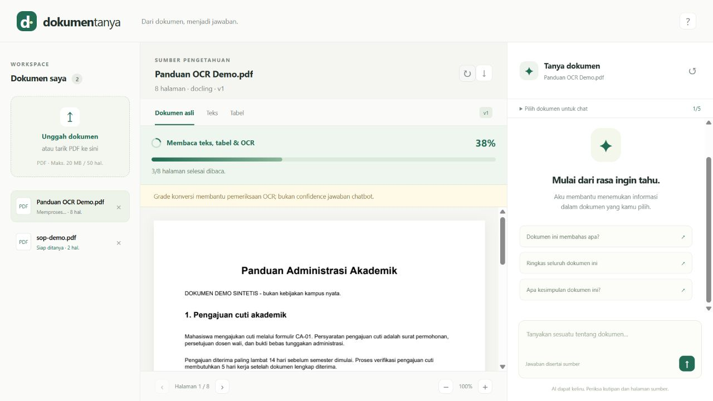
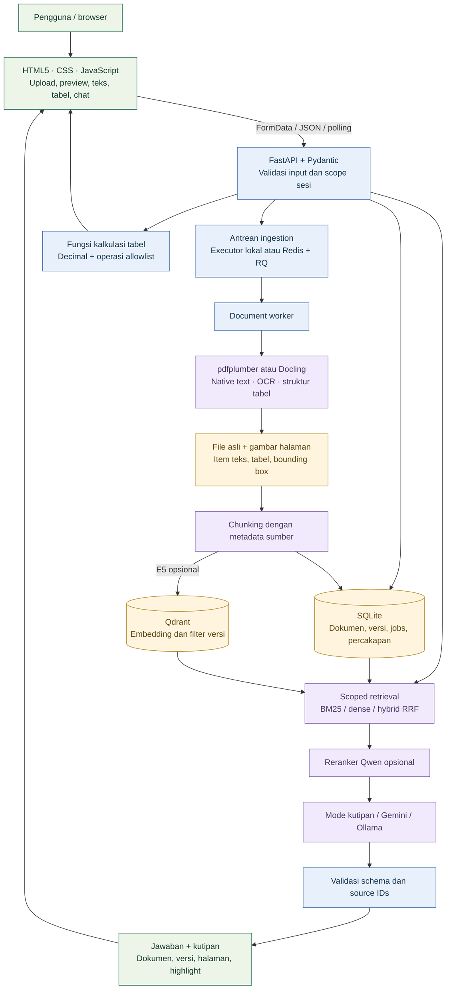
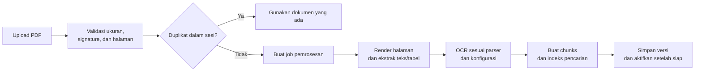
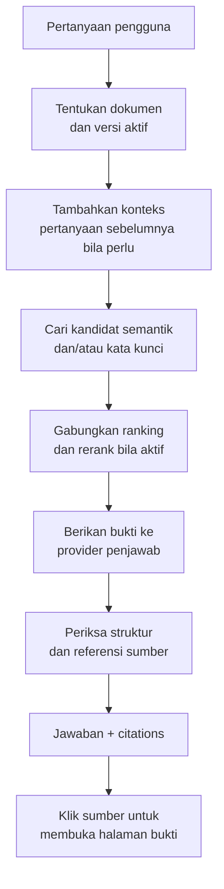
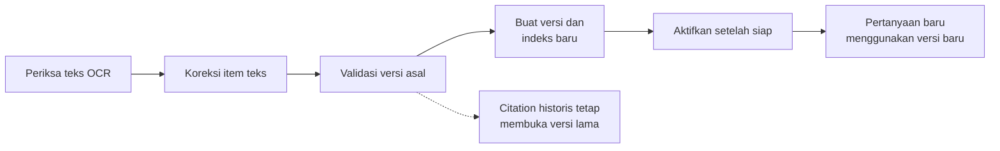
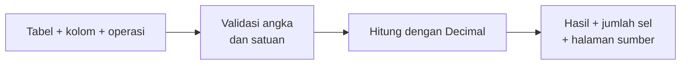

<div align="center">
  <h1>📄 DokumenTanya</h1>
  <h3>Document Intelligence &amp; Verifiable RAG Workspace</h3>
  <p><strong>Baca dokumen. Ajukan pertanyaan. Periksa buktinya.</strong></p>
  <p>OCR, ekstraksi tabel, dan percakapan berbasis dokumen dalam workspace HTML yang dapat dijalankan sendiri.</p>
  <p>
    
    
    
    
    
    
  </p>

[](https://github.com/zeyniaa/DokumenTanya/actions/workflows/ci.yml)

[Gambaran proyek](#gambaran-proyek) · [Arsitektur](#arsitektur-sistem) · [Alur kerja](#alur-kerja) · [Mulai cepat](#mulai-cepat) · [Aktifkan AI](#aktifkan-ai) · [Evaluasi](#evaluasi)

</div>

---

<a id="showcase"></a>

## 🖥️ Workspace Showcase



**Dokumen di kiri, bukti di tengah, percakapan di kanan.** Tombol sumber membuka halaman asli dan menyorot area hasil ekstraksi. Pada ponsel, workspace berubah menjadi tab Dokumen, Preview, dan Chat.


> Screenshot menggunakan PDF sintetis proyek. Screenshot menunjukkan **38% ketika 3 dari 8 halaman selesai dibaca**. Hasil uji percakapan **Ollama + Qwen3 4B lokal** tersedia pada [rekaman pengujian](docs/ollama-smoke.json). Badge Mode kutipan dan blok contoh di sidebar telah dihapus. Clone tetap memiliki baseline tanpa LLM; aktifkan Ollama untuk ringkasan dan penjelasan generatif.

---

<a id="gambaran-proyek"></a>

## 📝 Gambaran Proyek

**DokumenTanya** membantu pengguna menemukan informasi dalam SOP, panduan administrasi, laporan, dan PDF hasil scan. Sistem mengubah dokumen menjadi teks serta tabel yang dapat dicari, lalu menghubungkan jawaban dengan kutipan, nomor halaman, dan versi sumber.

Proyek ini dibangun sebagai portofolio **AI Engineer** dengan perhatian pada alur data dan evaluasi: ingestion, OCR, chunking, retrieval, generation, provenance, antarmuka, serta pemrosesan background.

Empat kemampuan utamanya:

1. **📥 Document ingestion:** menerima PDF, membaca teks/layout/tabel, menjalankan OCR sesuai konfigurasi, dan menampilkan animasi serta persentase halaman yang selesai dibaca.
2. **💬 Document question answering:** mencari bukti dalam 1–5 dokumen terpilih, menjelaskan topik dan kesimpulan serta menggunakan konteks percakapan lanjutan, dan menyajikan jawaban beserta sumber.
3. **✏️ Versioned OCR correction:** memperbaiki teks ekstraksi, membuat indeks versi baru, dan mempertahankan sumber jawaban historis.
4. **🧮 Deterministic table calculations:** menghitung angka dengan Decimal dan operasi yang dibatasi, sehingga perhitungan tidak bergantung pada tebakan LLM.

**Cakupan awal:** PDF digital dan scan dengan teks cetak Indonesia/Inggris, tabel sederhana, maksimal **20 MB dan 50 halaman per dokumen**. Chat lintas bahasa dirancang untuk konfigurasi embedding multilingual + LLM; mode BM25/kutipan lebih bergantung pada kesamaan istilah.

---

<a id="arsitektur-sistem"></a>

## 🌐 Arsitektur Sistem



Frontend dan API disajikan pada origin yang sama. Model serta API key berada di backend. Pencarian dibatasi pada dokumen dan versi yang diizinkan sebelum pemeringkatan.

Validasi source ID memastikan sumber berasal dari konteks yang diberikan; dukungan isi klaim tetap perlu dievaluasi. Penjelasan lebih lengkap tersedia di [docs/ARCHITECTURE.md](docs/ARCHITECTURE.md).

---

<a id="alur-kerja"></a>

## 🔄 Alur Kerja Utama

### A. Upload, Parsing, dan OCR



Halaman asli, posisi sumber, dan hasil ekstraksi disimpan untuk preview. Error format, scan tanpa OCR, atau kegagalan model ditampilkan sebagai pekerjaan gagal yang dapat diperiksa dan dicoba lagi.

Progres membaca dihitung dari **halaman selesai / seluruh halaman × 100**, bukan timer. Saat render atau model pertama kali dimuat, angka tetap 0% dan tahap yang sedang berjalan ditampilkan. Setelah pembacaan mencapai 100%, sistem masih membuat indeks; chat diaktifkan setelah status **Siap**. Progres disimpan di SQLite dan dapat dimuat ulang. Pada Docling, konversi memakai `page_range` per halaman dengan nomor dan posisi sumber asli. Tabel yang bersambung antarhalaman belum digabung otomatis.

### B. Pertanyaan dan Jawaban Bersumber



Setiap pesan memiliki request ID untuk mencegah generation ganda pada retry yang sudah selesai. Pertanyaan topik, kesimpulan, dan ringkasan membaca seluruh dokumen. Dokumen kecil diberikan langsung ke LLM; dokumen panjang memakai map/reduce bertahap yang mengikuti pertanyaan pengguna. Tiga giliran terakhir membantu pertanyaan seperti “jelaskan lebih sederhana”, tetapi jawaban lama tidak menjadi sumber fakta; mode kutipan menampilkan bagian dokumen dengan batas yang dijelaskan di UI.

### C. Koreksi Teks dan Versi Indeks



Koreksi memperbarui hasil ekstraksi, bukan file PDF asli. Jika parser atau model embedding diganti, tombol **Proses ulang dokumen** membangun versi baru dengan konfigurasi server saat ini.

### D. Perhitungan Tabel

Pertanyaan hitungan otomatis dijalankan hanya jika satu kolom tabel dapat ditentukan secara unik. Jika ambigu, pengguna memilih tabel, kolom, dan operasi melalui tab **Tabel**.



Operasi tersedia: **sum, average, min, max, count**. Format angka Indonesia diperiksa secara eksplisit; nilai ambigu atau satuan bercampur ditolak. Sistem tidak mengeksekusi Python atau SQL bebas yang dihasilkan model.

---

<a id="fitur-dan-mode"></a>

## 🧩 Fitur dan Mode Operasi

| Kemampuan | Implementasi | Keterangan |
| :--- | :--- | :--- |
| Workspace dokumen | HTML/CSS/ES modules | Upload, daftar dokumen, preview, zoom, navigasi halaman |
| Ekstraksi terstruktur | pdfplumber / Docling | Teks, tabel, halaman, dan posisi sumber |
| OCR | RapidOCR; Tesseract pada Docling | Tesseract memerlukan traineddata bahasa yang sesuai |
| Retrieval | BM25, E5/Qdrant, RRF | Dense/hybrid neural membutuhkan konfigurasi E5 dan Qdrant |
| Jawaban bersumber | Extractive, Gemini, Ollama | Provider dapat diperiksa di bantuan dan metadata jawaban |
| Chat beberapa dokumen | Scope 1–5 dokumen | Riwayat terikat pada sesi browser |
| Koreksi dan reprocess | Versi ekstraksi immutable | Versi lama tetap tersedia untuk citations |
| Perhitungan | Decimal + allowlist | Pemilihan tabel/kolom melalui UI jika ambigu |
| Ekspor | JSON / Markdown | Hasil ekstraksi dapat diunduh |
| Pemrosesan background | Executor lokal / Redis + RQ | Progres halaman nyata, animasi, polling status, deduplikasi, retry |
| Percakapan interaktif | Konteks 3 giliran terakhir | Overview, kesimpulan, ringkasan, dan penjelasan lanjutan |
| Pengujian | pytest, smoke checks, CI | Hasil aktual dan batas verifikasi terdokumentasi |

| Mode | Parser | Retrieval | Jawaban | Kebutuhan |
| :--- | :--- | :--- | :--- | :--- |
| **Lokal dasar** | pdfplumber | BM25 | Kutipan relevan | Python, tanpa API key |
| **Lokal + OCR** | pdfplumber + RapidOCR | BM25 | Kutipan relevan | Extra `ocr` |
| **Document AI** | Docling + OCR | E5/Qdrant + BM25 | Gemini atau Ollama | Extra `ai`/`ocr`, Qdrant, model/key |

**Mode dasar adalah baseline extractive.** Jawaban generatif membutuhkan Gemini API key atau server Ollama. Provider yang gagal menghasilkan error; sistem tidak mengarang respons pengganti.

---

<a id="technology-stack"></a>

## 💻 Technology Stack

| Layer | Teknologi | Peran |
| :--- | :--- | :--- |
| **Frontend** | Semantic HTML5, CSS, vanilla JavaScript | Workspace responsif, state UI, fetch, dan polling; tanpa build frontend |
| **API** | Python 3.11–3.13, FastAPI, Pydantic | Validasi request, endpoint dokumen/chat, file response |
| **Parsing** | pdfplumber, pypdfium2, Docling | Ekstraksi native, rendering halaman, layout dan tabel |
| **OCR** | RapidOCR + ONNX Runtime | Pengenalan teks pada scan |
| **Embedding** | Sentence Transformers, multilingual E5 Small | Embedding 384 dimensi, prefix query/passage, batas input 512 token |
| **Retrieval** | Qdrant, BM25, Reciprocal Rank Fusion | Pencarian semantik/kata kunci dengan filter scope |
| **Reranking** | Qwen3-Reranker-0.6B, opsional | Mengurutkan ulang kandidat; perlu profiling tambahan |
| **Generation** | Google GenAI SDK / Ollama HTTP API | Structured claims dan source IDs |
| **Metadata** | SQLite dengan WAL | Dokumen, versi, jobs, percakapan, dan jawaban |
| **Worker** | ThreadPoolExecutor / Redis + RQ | Antrean lokal atau worker proses terpisah |
| **Calculations** | Python Decimal | Perhitungan tabel dan validasi angka |
| **Reproducibility** | uv.lock, Docker Compose, GitHub Actions | Dependency terkunci dan pemeriksaan otomatis |

---

## Mulai cepat

Prasyarat: [Python 3.11–3.13](https://www.python.org/downloads/), [Git](https://git-scm.com/), dan [uv](https://docs.astral.sh/uv/getting-started/installation/). Perintah dijalankan dari root repository. `uv.lock` menyimpan versi dependency yang diselesaikan.

```bash
git clone https://github.com/zeyniaa/DokumenTanya.git
cd DokumenTanya
uv sync --frozen --extra dev
```

Salin konfigurasi untuk Windows PowerShell:

```powershell
Copy-Item .env.example .env
uv run --extra dev uvicorn backend.app.main:app --host 127.0.0.1 --port 8000
```

Atau Linux/macOS:

```bash
cp .env.example .env
uv run --extra dev uvicorn backend.app.main:app --host 127.0.0.1 --port 8000
```

Buka **http://127.0.0.1:8000**, lalu unggah PDF milikmu atau `examples/sop-demo.pdf`. Swagger API tersedia di **http://127.0.0.1:8000/docs**.

Pertanyaan yang bisa dicoba:

- Apa persyaratan pengajuan cuti?
- Berapa lama verifikasi cuti?
- Berapa total biaya administrasi?
- Ringkas seluruh dokumen ini.

Tab **Teks** menyediakan koreksi. Tab **Tabel** menyediakan pilihan kolom/operasi. Klik sumber jawaban untuk membuka bukti halaman.

Jangan membuka index.html langsung dengan file://; UI memakai API dan cookie sesi yang disajikan FastAPI. Dependency `dev` diperlukan untuk tests dan membuat ulang contoh PDF, bukan untuk menjalankan server dari lingkungan yang sudah terpasang.

## Aktifkan OCR

```bash
uv sync --frozen --extra dev --extra ocr
```

Ubah `.env`:

```dotenv
PARSER_BACKEND=pdfplumber
OCR_ENABLED=true
```

Jalankan server dengan extra yang sama, agar uv tidak menghapus dependency opsional:

```bash
uv run --extra dev --extra ocr uvicorn backend.app.main:app --host 127.0.0.1 --port 8000
```

Unggah `examples/sop-scan-demo.pdf`. Parser ringan memakai OCR pada halaman dengan sedikit teks native; deteksi tabel pada scan memerlukan parser Docling. Model dapat diunduh saat pertama digunakan.

## Aktifkan AI

```bash
uv sync --frozen --extra dev --extra ai --extra ocr
```

Dependency dan model AI lebih besar. Siapkan ruang disk dan waktu untuk download pertama; CPU dapat digunakan untuk eksperimen kecil tetapi latensinya perlu diukur.

### Docling dan Gemini

Ubah `.env` berikut. API key dimasukkan hanya pada file lokal yang diabaikan Git:

```dotenv
PARSER_BACKEND=docling
OCR_ENABLED=true
OCR_ENGINE=rapidocr
LLM_PROVIDER=gemini
GEMINI_MODEL=gemini-3.5-flash-lite
GEMINI_API_KEY=isi_key_lokal_di_sini
```

```bash
uv run --extra dev --extra ai --extra ocr uvicorn backend.app.main:app --host 127.0.0.1 --port 8000
```

Konfigurasi ini dapat memakai BM25 dahulu. Untuk mengaktifkan semantic/hybrid retrieval, tambahkan Qdrant seperti di bawah. Saat provider Gemini dipakai, pertanyaan dan potongan bukti dikirim ke API Google. Gunakan data publik/sintetis untuk demo dan catat biaya berdasarkan usage aktual.

### Embedding E5 dan Qdrant

Untuk server lokal di luar Compose:

```bash
docker run --name dokumentanya-qdrant -p 127.0.0.1:6333:6333 -v dokumentanya-qdrant:/qdrant/storage qdrant/qdrant:v1.19.1
```

```dotenv
EMBEDDING_BACKEND=e5
EMBEDDING_MODEL=intfloat/multilingual-e5-small
QDRANT_URL=http://127.0.0.1:6333
RETRIEVAL_MODE=hybrid
```

E5 menghasilkan 384 dimensi dan memakai prefix query/passage. Chunk neural dihitung menggunakan tokenizer model dan dibatasi di bawah input 512 token. Setelah mengubah parser/model, restart server dan klik **Proses ulang dokumen** untuk membuat versi indeks baru. Koleksi dipisahkan berdasarkan ID model; perubahan revision model dengan ID yang sama harus diperlakukan sebagai migrasi indeks tersendiri.

### Model lokal melalui Ollama

Untuk langsung memakai profil OCR + chatbot lokal, salin `.env.ollama.example` menjadi `.env` dan pasang dependency `uv sync --extra ai --extra ocr`. Profil ini memakai BM25 dan konteks dokumen tanpa layanan Qdrant tambahan.

Pasang [Ollama](https://ollama.com/), lalu:

```bash
ollama pull qwen3:4b
```

```dotenv
LLM_PROVIDER=ollama
OLLAMA_URL=http://127.0.0.1:11434
OLLAMA_MODEL=qwen3:4b
LLM_TIMEOUT=240
```

Pastikan layanan Ollama berjalan (`ollama serve` bila belum berjalan), lalu restart FastAPI agar perubahan `.env` terbaca. Periksa model dengan `ollama list`. Smoke check lokal memakai `qwen3:4b`. Jika memakai model lain, sesuaikan `OLLAMA_MODEL` dan ulangi pengujian karena kepatuhan format serta kualitas jawaban dapat berbeda.

Ollama dipanggil dari backend dengan structured JSON, konteks 8192 token, dan temperature 0.2. PDF serta percakapan diproses melalui server lokal tanpa Gemini API key. Ukuran model download berbeda dari kebutuhan memori runtime. Profilkan perangkat sebelum menjalankan OCR, embedding, reranker, dan LLM secara bersamaan.

Contoh pertanyaan setelah OCR siap:

- “Dokumen ini membahas apa?” untuk jenis, tujuan, dan topik utama.
- “Apa kesimpulannya?” untuk kesimpulan dari seluruh dokumen.
- “Jelaskan lebih sederhana” untuk melanjutkan jawaban sebelumnya dengan bahasa sehari-hari.
- “Apa syarat pengajuan cuti?” untuk detail dengan sumber halaman.

OCR tidak melatih ulang model. Hasil teks dan tabel diberikan sebagai konteks saat menjawab; RAG memilih bukti dan server memeriksa referensi sumbernya. Dengan Ollama, proses generation berjalan di laptop. Untuk dokumen panjang, rangkuman bertahap memerlukan beberapa panggilan model dan bisa lebih lama.

Jalankan pemeriksaan dengan model lokal asli:

```bash
uv run python -m scripts.smoke_chat --output docs/ollama-smoke.json
```

### Reranker opsional

```dotenv
RERANKER_ENABLED=true
RERANKER_MODEL=Qwen/Qwen3-Reranker-0.6B
```

Reranker memperbesar kebutuhan memori dan latensi. Bandingkan hasilnya pada dataset yang sama sebelum menjadikannya default.

## Docker

Docker Desktop atau Docker Engine diperlukan. Compose menjalankan **API + worker RQ + Redis + Qdrant**. Hanya API diekspos pada loopback; metadata, file, indeks, dan cache model disimpan dalam volumes.

```bash
docker compose up --build
```

Compose memasang dependency OCR. Jika `.env` berasal dari contoh dasar, ubah `OCR_ENABLED=true` untuk membaca scan. Untuk membangun seluruh dependency AI, tambahkan:

```dotenv
INSTALL_AI=true
PARSER_BACKEND=docling
OCR_ENABLED=true
EMBEDDING_BACKEND=e5
LLM_PROVIDER=gemini
GEMINI_API_KEY=isi_key_lokal_di_sini
```

Kemudian jalankan ulang `docker compose up --build`. Worker RQ berjalan di container Linux, sehingga tidak bergantung pada fork() Windows. Jika memakai Ollama pada host, set `OLLAMA_URL=http://host.docker.internal:11434`; Linux memerlukan konfigurasi host gateway yang sesuai.

Mode lokal JOB_BACKEND=local hanya untuk pengembangan dengan **satu proses Uvicorn**. Hindari reload/multi-worker saat ingestion sedang berjalan. Pekerjaan yang terhenti ditandai gagal dan dapat dicoba lagi. Gunakan RQ untuk layanan yang memerlukan worker terpisah.

---

## API utama

| Endpoint | Fungsi |
|---|---|
| `POST /api/documents` | Upload PDF dan membuat job |
| `GET /api/jobs/{id}` | Status dan error pemrosesan |
| `GET /api/documents/{id}/extraction` | Items/tabel; mendukung version_id |
| `GET /api/documents/{id}/pages/{page}` | Preview halaman versi yang diizinkan |
| `PATCH /api/documents/{id}/items/{item}` | Koreksi teks dan indeks ulang |
| `POST /api/documents/{id}/reprocess` | Versi baru dengan parser/model aktif |
| `POST /api/documents/{id}/calculate` | Operasi tabel tervalidasi |
| `POST /api/conversations` | Scope 1–5 dokumen |
| `POST /api/conversations/{id}/messages` | Chat idempotent bersumber |
| `GET /api/conversations/{id}/messages` | Riwayat dan citation historis |
| `DELETE /api/documents/{id}` | Hapus semua versi/index dan chat terkait |

Dokumentasi schema lengkap tersedia melalui Swagger ketika server berjalan.

---

## Evaluasi

```bash
uv run --extra dev pytest -q
uv run --extra dev ruff check backend tests scripts evals
uv run --extra dev python evals/run.py
```

Runner evaluasi memerlukan server aktif. Dataset pilot berisi delapan pertanyaan pada PDF sintetis; hasil ditulis ke `evals/results/pilot.json`. Pemeriksaan substring bukan evaluasi semantic correctness. Baseline dapat mengambil bukti yang relevan tetapi tetap gagal memberi status abstention yang tepat; failure ini sengaja dicatat.

Tests mencakup upload, citation, isolasi sesi, versi koreksi, hitungan, idempotency, error file/scan, export, deletion, dan provider contract. Optional real-model smoke checks tersedia di [EVALUATION.md](docs/EVALUATION.md).

Lihat [catatan verifikasi](docs/VERIFICATION.md) untuk membedakan pemeriksaan yang dijalankan dari integrasi yang belum diuji langsung. Tidak ada klaim akurasi produksi dari dataset demo.

### Hasil verifikasi yang tercatat

| Pemeriksaan | Hasil | Cakupan |
| :--- | :--- | :--- |
| **Automated tests lokal** | **25 passed** | Workflow, isolasi sesi, citations, koreksi/reprocess, hitungan, idempotency, provider contract |
| **Ruff & JavaScript syntax** | **Passed** | Kode Python dan semua ES modules frontend |
| **Browser desktop & mobile** | **Baseline diperiksa** | Upload/chat/citation pada 12 Oktober; pemeriksaan baru 15 Oktober terhenti karena URL browser tidak dapat diverifikasi |
| **RapidOCR** | **Passed** | PDF scan sintetis dengan model OCR asli |
| **Docling** | **Passed** | Teks dan satu tabel pada PDF sintetis |
| **E5 + Qdrant in-memory** | **Passed** | Model asli, 384 dimensi, filter owner/versi |
| **Pilot benchmark** | **7/8 checks passed** | Delapan pertanyaan sintetis; pemeriksaan substring |
| **Gemini** | **Schema diperiksa** | API key belum tersedia untuk live generation |
| **Ollama + Qwen3 4B lokal** | **Live generation diperiksa** | Overview, kesimpulan, dan pertanyaan lanjutan pada PDF sintetis; bukan benchmark akurasi |
| **Qwen reranker / Docker stack** | **Belum diuji langsung** | Implementasi/configuration tersedia |

Catatan lengkap: [VERIFICATION.md](docs/VERIFICATION.md). Hasil pilot adalah smoke benchmark, bukan klaim akurasi pada dokumen nyata. Kegagalan pertanyaan tentang nomor telepon yang tidak tercantum tetap dicatat dalam [hasil pilot](docs/pilot-results.json).

---

## 📂 Struktur Repository

```text
DokumenTanya/
├── backend/app/
│   ├── main.py              # FastAPI, endpoint, session scope
│   ├── config.py            # Environment dan validasi konfigurasi
│   ├── store.py             # SQLite metadata dan versi
│   ├── jobs.py              # Ingestion dan aktivasi indeks
│   ├── worker.py            # Worker Redis/RQ
│   └── services/            # Parser, retrieval, generation, calculations
├── frontend/
│   ├── index.html           # Workspace satu halaman
│   └── assets/
│       ├── css/             # Design dan layout responsif
│       └── js/              # Upload, viewer, chat, API, dan state
├── examples/                # PDF digital dan scan sintetis
├── scripts/                 # Generator contoh dan smoke checks
├── tests/                   # Workflow, provider contract, dan metrics
├── evals/                   # Dataset pilot dan runner benchmark
├── docs/                    # Arsitektur, evaluasi, screenshot, verifikasi
├── .github/workflows/ci.yml  # Tes dan pemeriksaan syntax
├── .env.example             # Contoh konfigurasi tanpa secret
├── pyproject.toml
├── uv.lock
├── Dockerfile
└── compose.yaml
```

Direktori runtime `data/` dibuat saat aplikasi dijalankan dan diabaikan Git. Isinya mencakup file upload, gambar halaman, database, session key, dan cache model.

---

<a id="faq"></a>

## ❓ Pertanyaan Umum

**Mengapa pemrosesan PDF bisa lama?**

Docling menjalankan analisis layout dan tabel, serta OCR bila aktif. Scan, jumlah halaman, tabel rumit, penggunaan CPU, dan download model pertama memengaruhi durasi. OCR tidak diulang untuk setiap pertanyaan: chat membaca indeks versi yang sudah siap.

**Apakah dokumen Inggris bisa dibaca?**

Parser mendukung ekstraksi teks Inggris. Mode kutipan menggunakan pencarian kata kunci; pertanyaan Indonesia terhadap teks Inggris dapat kehilangan kecocokan. E5 + LLM dirancang untuk pencarian multilingual dan jawaban Indonesia, tetapi kualitas lintas bahasa masih perlu diuji pada dataset yang sesuai.

**Apakah bisa dicoba tanpa API key?**

Bisa. Mode lokal dasar memakai PDF extraction, BM25, dan kutipan. Label UI memperjelas bahwa mode ini belum menyusun jawaban LLM.

**Apa yang perlu dilakukan setelah mengganti model atau parser?**

Restart server, lalu klik **Proses ulang dokumen**. Ini membangun versi baru. Jawaban historis tetap mengacu pada sumber versi sebelumnya.

**Apakah pengguna memiliki akun login?**

Saat ini workspace dipisahkan oleh signed cookie sesi. Ini bukan autentikasi akun. Menghapus cookie membuat workspace lama tidak dapat diakses dari browser tersebut, tetapi tidak menghapus data server.

---

## Batas dan penggunaan data

- Cakupan awal: teks cetak Indonesia/Inggris, PDF maksimal 20 MB/50 halaman, tabel sederhana. Tulisan tangan, tabel lintas halaman, dan grafik kompleks belum menjadi cakupan yang teruji.
- ID sumber yang valid membuktikan lokasi sumber ada; belum membuktikan semua klaim mengikuti sumber. Periksa bukti dan evaluasi claim support.
- Highlight menunjukkan area sumber yang diekstrak, bukan bukti entailment per kata.
- Follow-up memakai heuristik pertanyaan sebelumnya; percakapan panjang dan ambigu perlu evaluasi tambahan.
- Koreksi UI tersedia untuk teks. Edit sel tabel belum tersedia; perhitungan menolak angka/satuan ambigu.
- Isolasi cookie sesi belum merupakan autentikasi akun. Jangan membuka upload publik tanpa HTTPS, autentikasi, rate limit bersama, retensi, dan batas sumber daya.
- `.env`, file upload, database, cache model, dan session key tidak masuk Git. Jangan menambahkan secret atau dokumen pribadi ke repository.

## Referensi

Fondasi dan pola yang dipelajari:

- [Docling](https://github.com/docling-project/docling): parsing, OCR, struktur tabel, provenance.
- [Docling RAG](https://docling-project.github.io/docling/_generated/examples/rag_langchain/) dan [visual grounding](https://docling-project.github.io/docling/_generated/examples/visual_grounding/).
- [Kotaemon](https://github.com/Cinnamon/kotaemon): referensi chat dokumen dengan citations/preview.
- [Multilingual E5](https://huggingface.co/intfloat/multilingual-e5-small), [Qwen reranker](https://huggingface.co/Qwen/Qwen3-Reranker-0.6B).
- [Qdrant](https://qdrant.tech/documentation/search/hybrid-queries/): pencarian vektor dan hybrid.
- [FastAPI](https://fastapi.tiangolo.com/) dan [MDN Fetch](https://developer.mozilla.org/en-US/docs/Web/API/Fetch_API/Using_Fetch).
- [BaliTowerOps](https://github.com/daffaarigoh/BaliTowerOps): referensi struktur presentasi README, diagram arsitektur/alur kerja, dan tabel stack. Implementasi DokumenTanya berfokus pada Document AI.
- [Gemini structured outputs](https://ai.google.dev/gemini-api/docs/structured-output), [Ollama](https://ollama.com/).

Kode proyek berlisensi [MIT](LICENSE). Dependency, model, dan dataset memiliki lisensi masing-masing.

---

Dibangun oleh [zeyniaa](https://github.com/zeyniaa) sebagai proyek portofolio AI Engineer.
