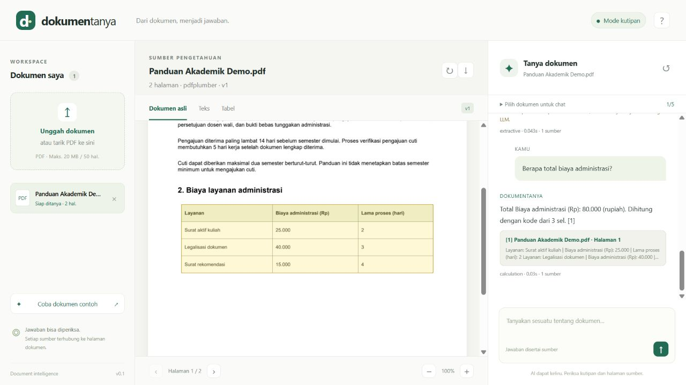
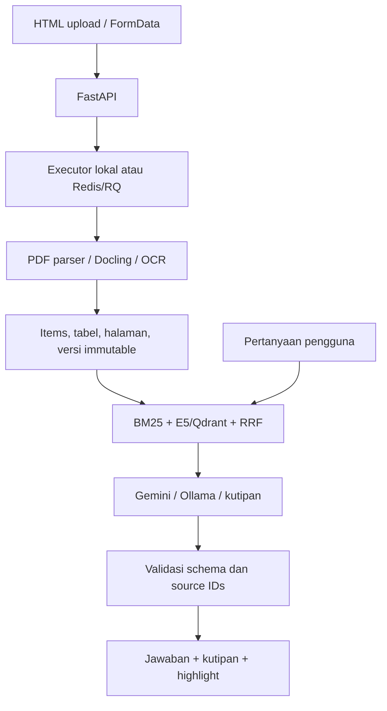

<div align="center">

# DokumenTanya

**Baca dokumen. Ajukan pertanyaan. Periksa buktinya.**

Document AI workspace untuk PDF berbahasa Indonesia: OCR, tabel, pencarian hybrid, dan jawaban dengan sumber halaman.

[](https://github.com/zeyniaa/dokumentanya/actions/workflows/ci.yml)


[Mulai cepat](#mulai-cepat) · [Aktifkan AI](#aktifkan-ai) · [Docker](#docker) · [Evaluasi](#evaluasi) · [Arsitektur](docs/ARCHITECTURE.md)

</div>



> Screenshot menunjukkan aplikasi lokal dengan dokumen sintetis dan mode kutipan. Mode ini benar-benar mengekstrak PDF dan mencari bukti, tetapi tidak memanggil LLM.

## Mengapa proyek ini?

Informasi pada SOP dan panduan administrasi sering tersebar dalam paragraf, scan, dan tabel. DokumenTanya menghubungkan pertanyaan pengguna dengan bukti yang dapat diperiksa pada dokumen asli. Pengguna dapat memeriksa OCR, memperbaiki teks yang salah, dan melihat versi sumber yang dipakai oleh jawaban sebelumnya.

Proyek ini memperlihatkan alur AI engineering dari ingestion sampai evaluasi: parsing, provenance, versioning, retrieval, generation, antarmuka, dan operasi layanan. Dataset demo dibuat khusus untuk proyek ini dan tidak berisi data pribadi.

## Fitur

- **Workspace HTML/CSS/JavaScript** dengan panel dokumen, preview, dan chat; responsif untuk ponsel.
- **PDF digital dan scan:** parser ringan atau Docling; RapidOCR untuk scan, opsi Tesseract pada Docling.
- **Preview dokumen, teks, dan tabel**, navigasi halaman, zoom, serta ekspor JSON/Markdown.
- **Pencarian BM25 atau E5 + Qdrant**, penggabungan RRF, dan reranker Qwen opsional.
- **Chat dengan sumber:** kutipan, halaman, versi, dan highlight area pada dokumen asli.
- **Percakapan 1–5 dokumen**, riwayat tersimpan, dan konteks pertanyaan lanjutan.
- **Koreksi teks OCR berversi:** indeks baru diaktifkan setelah siap; sumber jawaban lama tetap tersedia.
- **Perhitungan tabel dengan Decimal:** jumlah, rata-rata, minimum, maksimum, dan jumlah sel.
- **Ringkasan seluruh dokumen secara bertahap** pada provider LLM; asal sumber dipertahankan.
- **Worker pemrosesan, status, retry eksplisit, dan deduplikasi upload.**
- **Isolasi sesi browser**, validasi file, proteksi origin, dan penghapusan dokumen beserta indeks/percakapan terkait.
- **Tests, CI, PDF sintetis, dan runner evaluasi** yang menyimpan konfigurasi serta hasil aktual.

## Mode yang tersedia

| Mode | Parser | Retrieval | Jawaban | Kebutuhan |
|---|---|---|---|---|
| Lokal dasar | pdfplumber | BM25 | Kutipan relevan | Python; tanpa API key |
| Lokal + OCR | pdfplumber + RapidOCR | BM25 | Kutipan relevan | Extra `ocr` |
| Document AI | Docling + OCR | E5/Qdrant + BM25 | Gemini atau Ollama | Extra `ai`/`ocr`, Qdrant, model/key |

**Mode dasar adalah baseline extractive, bukan jawaban generatif.** Label provider terlihat di UI. Tidak ada penggantian diam-diam ke jawaban palsu ketika model atau API gagal.

## Mulai cepat

Prasyarat: [Python 3.11–3.13](https://www.python.org/downloads/), [Git](https://git-scm.com/), dan [uv](https://docs.astral.sh/uv/getting-started/installation/). Perintah dijalankan dari root repository. `uv.lock` menyimpan versi dependency yang diselesaikan.

```bash
git clone https://github.com/zeyniaa/dokumentanya.git
cd dokumentanya
uv sync --frozen --extra dev
```

Salin konfigurasi untuk Windows PowerShell:

```powershell
Copy-Item .env.example .env
uv run --extra dev uvicorn backend.app.main:app --host 127.0.0.1 --port 8000
```

Atau Linux/macOS:

```bash
cp .env.example .env
uv run --extra dev uvicorn backend.app.main:app --host 127.0.0.1 --port 8000
```

Buka **http://127.0.0.1:8000**, lalu klik **Coba dokumen contoh**. Swagger API tersedia di **http://127.0.0.1:8000/docs**.

Pertanyaan yang bisa dicoba:

- Apa persyaratan pengajuan cuti?
- Berapa lama verifikasi cuti?
- Berapa total biaya administrasi?
- Ringkas seluruh dokumen ini.

Tab **Teks** menyediakan koreksi. Tab **Tabel** menyediakan pilihan kolom/operasi. Klik sumber jawaban untuk membuka bukti halaman.

Jangan membuka index.html langsung dengan file://; UI memakai API dan cookie sesi yang disajikan FastAPI. Dependency `dev` diperlukan untuk tests dan membuat ulang contoh PDF, bukan untuk menjalankan server dari lingkungan yang sudah terpasang.

## Aktifkan OCR

```bash
uv sync --frozen --extra dev --extra ocr
```

Ubah `.env`:

```dotenv
PARSER_BACKEND=pdfplumber
OCR_ENABLED=true
```

Jalankan server dengan extra yang sama, agar uv tidak menghapus dependency opsional:

```bash
uv run --extra dev --extra ocr uvicorn backend.app.main:app --host 127.0.0.1 --port 8000
```

Unggah `examples/sop-scan-demo.pdf`. Parser ringan memakai OCR pada halaman dengan sedikit teks native; deteksi tabel pada scan memerlukan parser Docling. Model dapat diunduh saat pertama digunakan.

## Aktifkan AI

```bash
uv sync --frozen --extra dev --extra ai --extra ocr
```

Dependency dan model AI lebih besar. Siapkan ruang disk dan waktu untuk download pertama; CPU dapat digunakan untuk eksperimen kecil tetapi latensinya perlu diukur.

### Docling dan Gemini

Ubah `.env` berikut. API key dimasukkan hanya pada file lokal yang diabaikan Git:

```dotenv
PARSER_BACKEND=docling
OCR_ENABLED=true
OCR_ENGINE=rapidocr
LLM_PROVIDER=gemini
GEMINI_MODEL=gemini-3.5-flash-lite
GEMINI_API_KEY=isi_key_lokal_di_sini
```

```bash
uv run --extra dev --extra ai --extra ocr uvicorn backend.app.main:app --host 127.0.0.1 --port 8000
```

Konfigurasi ini dapat memakai BM25 dahulu. Untuk mengaktifkan semantic/hybrid retrieval, tambahkan Qdrant seperti di bawah. Saat provider Gemini dipakai, pertanyaan dan potongan bukti dikirim ke API Google. Gunakan data publik/sintetis untuk demo dan catat biaya berdasarkan usage aktual.

### Embedding E5 dan Qdrant

Untuk server lokal di luar Compose:

```bash
docker run --name dokumentanya-qdrant -p 127.0.0.1:6333:6333 -v dokumentanya-qdrant:/qdrant/storage qdrant/qdrant:v1.19.1
```

```dotenv
EMBEDDING_BACKEND=e5
EMBEDDING_MODEL=intfloat/multilingual-e5-small
QDRANT_URL=http://127.0.0.1:6333
RETRIEVAL_MODE=hybrid
```

E5 menghasilkan 384 dimensi dan memakai prefix query/passage. Chunk neural dihitung menggunakan tokenizer model dan dibatasi di bawah input 512 token. Setelah mengubah parser/model, restart server dan klik **Proses ulang dokumen** untuk membuat versi indeks baru. Koleksi dipisahkan berdasarkan ID model; perubahan revision model dengan ID yang sama harus diperlakukan sebagai migrasi indeks tersendiri.

### Model lokal melalui Ollama

Pasang [Ollama](https://ollama.com/), lalu:

```bash
ollama pull qwen3:8b
```

```dotenv
LLM_PROVIDER=ollama
OLLAMA_URL=http://127.0.0.1:11434
OLLAMA_MODEL=qwen3:8b
```

Ollama dipanggil dari backend dengan structured JSON. Ukuran model download berbeda dari kebutuhan memori runtime. Profilkan perangkat sebelum menjalankan OCR, embedding, reranker, dan LLM secara bersamaan.

### Reranker opsional

```dotenv
RERANKER_ENABLED=true
RERANKER_MODEL=Qwen/Qwen3-Reranker-0.6B
```

Reranker memperbesar kebutuhan memori dan latensi. Bandingkan hasilnya pada dataset yang sama sebelum menjadikannya default.

## Docker

Docker Desktop atau Docker Engine diperlukan. Compose menjalankan **API + worker RQ + Redis + Qdrant**. Hanya API diekspos pada loopback; metadata, file, indeks, dan cache model disimpan dalam volumes.

```bash
docker compose up --build
```

Compose memasang dependency OCR. Jika `.env` berasal dari contoh dasar, ubah `OCR_ENABLED=true` untuk membaca scan. Untuk membangun seluruh dependency AI, tambahkan:

```dotenv
INSTALL_AI=true
PARSER_BACKEND=docling
OCR_ENABLED=true
EMBEDDING_BACKEND=e5
LLM_PROVIDER=gemini
GEMINI_API_KEY=isi_key_lokal_di_sini
```

Kemudian jalankan ulang `docker compose up --build`. Worker RQ berjalan di container Linux, sehingga tidak bergantung pada fork() Windows. Jika memakai Ollama pada host, set `OLLAMA_URL=http://host.docker.internal:11434`; Linux memerlukan konfigurasi host gateway yang sesuai.

Mode lokal JOB_BACKEND=local hanya untuk pengembangan dengan **satu proses Uvicorn**. Hindari reload/multi-worker saat ingestion sedang berjalan. Pekerjaan yang terhenti ditandai gagal dan dapat dicoba lagi. Gunakan RQ untuk layanan yang memerlukan worker terpisah.

## Arsitektur



API key hanya berada di backend. Koreksi menghasilkan versi baru, sedangkan citation historis tetap merujuk ke versi lama. Perhitungan tabel menggunakan fungsi yang dibatasi, bukan kode yang dihasilkan model. Detail: [ARCHITECTURE.md](docs/ARCHITECTURE.md).

## API utama

| Endpoint | Fungsi |
|---|---|
| `POST /api/documents` | Upload PDF dan membuat job |
| `GET /api/jobs/{id}` | Status dan error pemrosesan |
| `GET /api/documents/{id}/extraction` | Items/tabel; mendukung version_id |
| `GET /api/documents/{id}/pages/{page}` | Preview halaman versi yang diizinkan |
| `PATCH /api/documents/{id}/items/{item}` | Koreksi teks dan indeks ulang |
| `POST /api/documents/{id}/reprocess` | Versi baru dengan parser/model aktif |
| `POST /api/documents/{id}/calculate` | Operasi tabel tervalidasi |
| `POST /api/conversations` | Scope 1–5 dokumen |
| `POST /api/conversations/{id}/messages` | Chat idempotent bersumber |
| `GET /api/conversations/{id}/messages` | Riwayat dan citation historis |
| `DELETE /api/documents/{id}` | Hapus semua versi/index dan chat terkait |

Dokumentasi schema lengkap tersedia melalui Swagger ketika server berjalan.

## Evaluasi

```bash
uv run --extra dev pytest -q
uv run --extra dev ruff check backend tests scripts evals
uv run --extra dev python evals/run.py
```

Runner evaluasi memerlukan server aktif. Dataset pilot berisi delapan pertanyaan pada PDF sintetis; hasil ditulis ke `evals/results/pilot.json`. Pemeriksaan substring bukan evaluasi semantic correctness. Baseline dapat mengambil bukti yang relevan tetapi tetap gagal memberi status abstention yang tepat; failure ini sengaja dicatat.

Tests mencakup upload, citation, isolasi sesi, versi koreksi, hitungan, idempotency, error file/scan, export, deletion, dan provider contract. Optional real-model smoke checks tersedia di [EVALUATION.md](docs/EVALUATION.md).

Lihat [catatan verifikasi](docs/VERIFICATION.md) untuk membedakan pemeriksaan yang dijalankan dari integrasi yang belum diuji langsung. Tidak ada klaim akurasi produksi dari dataset demo.

## Struktur repository

```text
backend/app/        API, metadata, jobs, worker, dan services AI
frontend/          HTML, CSS, dan JavaScript ES modules
examples/          PDF digital dan scan sintetis
scripts/           Generator contoh dan smoke checks model
tests/             Pengujian workflow dan kontrak layanan
evals/             Dataset pilot, runner, dan hasil lokal
docs/              Arsitektur, evaluasi, dan screenshot
```

## Batas dan penggunaan data

- Cakupan awal: teks cetak Indonesia/Inggris, PDF maksimal 20 MB/50 halaman, tabel sederhana. Tulisan tangan, tabel lintas halaman, dan grafik kompleks belum menjadi cakupan yang teruji.
- ID sumber yang valid membuktikan lokasi sumber ada; belum membuktikan semua klaim mengikuti sumber. Periksa bukti dan evaluasi claim support.
- Highlight menunjukkan area sumber yang diekstrak, bukan bukti entailment per kata.
- Follow-up memakai heuristik pertanyaan sebelumnya; percakapan panjang dan ambigu perlu evaluasi tambahan.
- Koreksi UI tersedia untuk teks. Edit sel tabel belum tersedia; perhitungan menolak angka/satuan ambigu.
- Isolasi cookie sesi belum merupakan autentikasi akun. Jangan membuka upload publik tanpa HTTPS, autentikasi, rate limit bersama, retensi, dan batas sumber daya.
- `.env`, file upload, database, cache model, dan session key tidak masuk Git. Jangan menambahkan secret atau dokumen pribadi ke repository.

## Referensi

Fondasi dan pola yang dipelajari:

- [Docling](https://github.com/docling-project/docling): parsing, OCR, struktur tabel, provenance.
- [Docling RAG](https://docling-project.github.io/docling/_generated/examples/rag_langchain/) dan [visual grounding](https://docling-project.github.io/docling/_generated/examples/visual_grounding/).
- [Kotaemon](https://github.com/Cinnamon/kotaemon): referensi chat dokumen dengan citations/preview.
- [Multilingual E5](https://huggingface.co/intfloat/multilingual-e5-small), [Qwen reranker](https://huggingface.co/Qwen/Qwen3-Reranker-0.6B).
- [Qdrant](https://qdrant.tech/documentation/search/hybrid-queries/): pencarian vektor dan hybrid.
- [FastAPI](https://fastapi.tiangolo.com/) dan [MDN Fetch](https://developer.mozilla.org/en-US/docs/Web/API/Fetch_API/Using_Fetch).
- [Gemini structured outputs](https://ai.google.dev/gemini-api/docs/structured-output), [Ollama](https://ollama.com/).

Kode proyek berlisensi [MIT](LICENSE). Dependency, model, dan dataset memiliki lisensi masing-masing.

---

Dibangun oleh [zeyniaa](https://github.com/zeyniaa) sebagai proyek portofolio AI Engineer.
