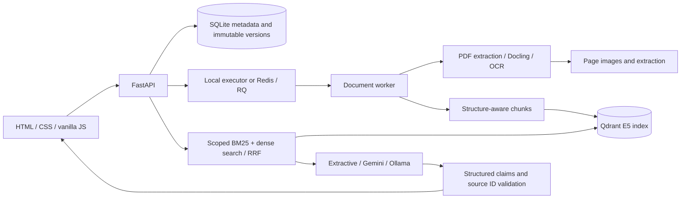

# Architecture

The browser owns presentation and interaction state. Python owns document data, model calls, session scope, provenance, and calculations. HTML/CSS/ES modules are served by FastAPI on the same origin; no frontend build is needed.

## Document lifecycle

1. Stream upload to a UUID-owned directory, enforce byte and page limits, inspect actual PDF signature, and reject unreadable/password-protected PDFs.
2. Dedupe by file hash within the signed session only.
3. Queue ingestion. Render pages at bounded resolution; extract native text, table rows, and normalized boxes. The lightweight parser applies OCR to pages with little native text. Docling handles its own OCR/layout pipeline.
4. Split document items into search chunks; E5 uses its own tokenizer and the required query/passage prefixes. Original item IDs and normalized page boxes remain available.
5. Index the new immutable version. Activate it only after successful index creation. Previous versions remain available for historical citations.
6. A correction changes extracted text only, records original text, and produces a new version/index. The original PDF and its page images remain immutable; the highlight points to the original location, not a rewritten PDF.

## Retrieval and generation

The conversation records 1–5 document IDs. Each new question resolves their current active versions. Both lexical corpus and dense query filters are restricted before ranking. RRF combines top-20 lists; the optional reranker scores the candidates. A deterministic follow-up heuristic includes the preceding user question, never an earlier generated answer as evidence.

Generation returns structured claims with source IDs. The server rejects IDs that were not supplied to the model. It attaches the actual quotation, document, version, page, and boxes from server data. This proves a citation exists; it does not prove the claim logically follows from it. Evaluate support manually or with a separate judge.

Requests containing an explicit whole-document summary use bounded map/reduce. Synthetic summary IDs carry unions of their original source IDs; final claims are expanded back to real chunks before rendering citations. This retains provenance but can yield broad citations and still omit details.

Simple calculation intents are intercepted only when exactly one table column matches. Otherwise the UI directs the user to select a table/column/operation. Calculations use Decimal and strict Indonesian number parsing. No generated Python or SQL is executed.

## Sessions and reliability

Signed HttpOnly SameSite cookies partition files and conversations. This is browser-session isolation, not user-account authentication. Losing cookies loses browser access to the old workspace; it does not delete stored data. A persistent session key lives under ignored data storage or is supplied by SESSION_SECRET.

The local single-worker executor is for development: interrupted jobs are explicitly marked failed on restart. Redis/RQ is the deployable process-separated queue. Polling detects failed/stopped RQ jobs. Retry is an explicit user action; transient provider errors never silently turn into invented answers.

An idempotency key is unique per conversation message. Completed retries return the saved response; in-flight duplicates return 409. Unknown network outcomes require reading history before a new generation request.

## Scope boundaries

Baseline mode is real native PDF extraction + BM25 + extractive quotations. It is not an LLM chatbot and does not provide robust semantic abstention. OCR, neural embeddings, Docling, reranker, and LLM are explicit configurable integrations. The UI reports the active provider.

The local app is bound to loopback; Docker exposes only the API on loopback. A public deployment needs HTTPS, an account identity, shared rate limiting/quotas, retention, monitoring, and a network boundary around Redis/Qdrant. API keys remain server-side. Raw user text is rendered as textContent in the browser.
